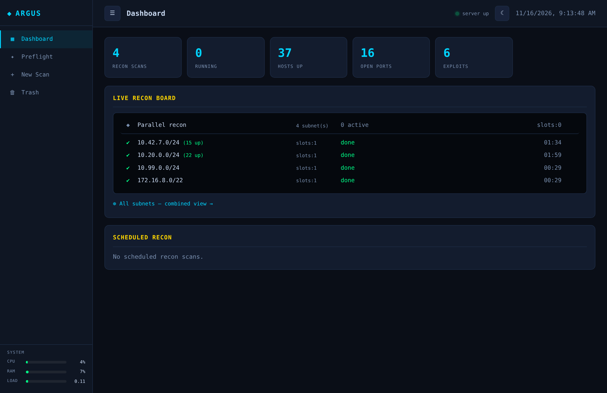
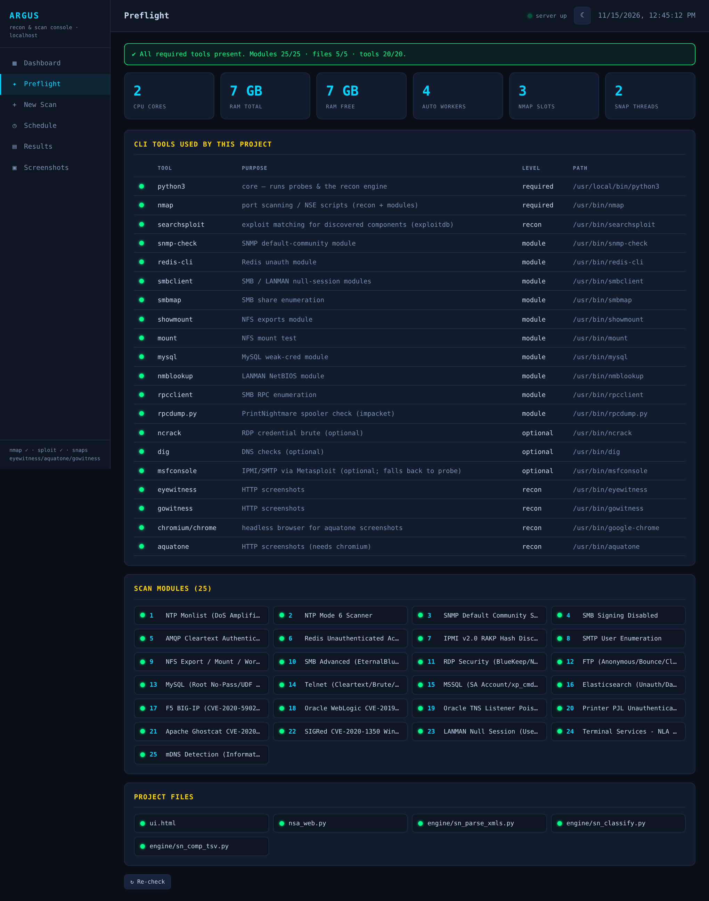
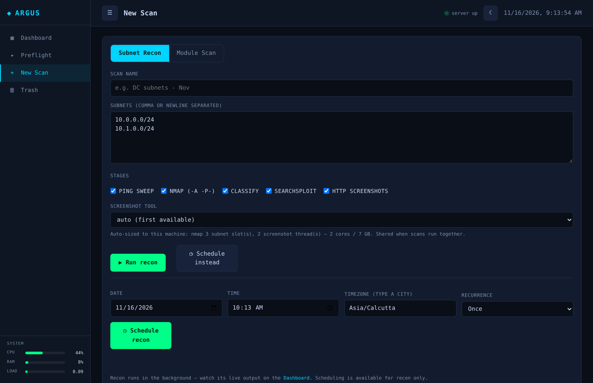
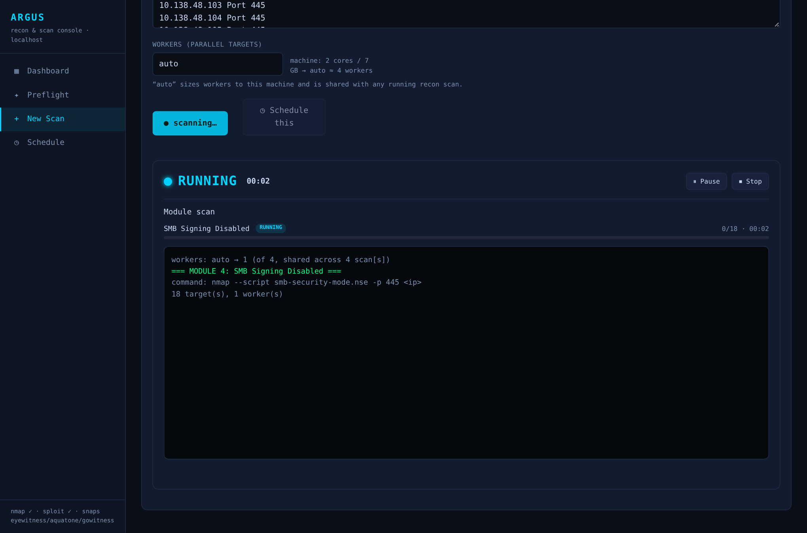
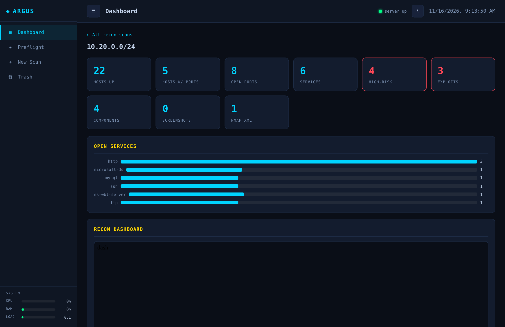
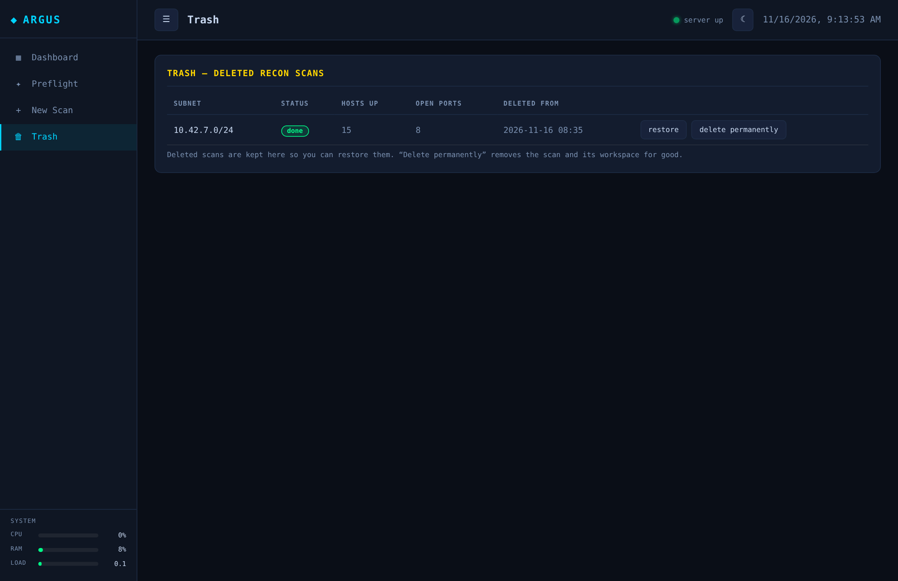
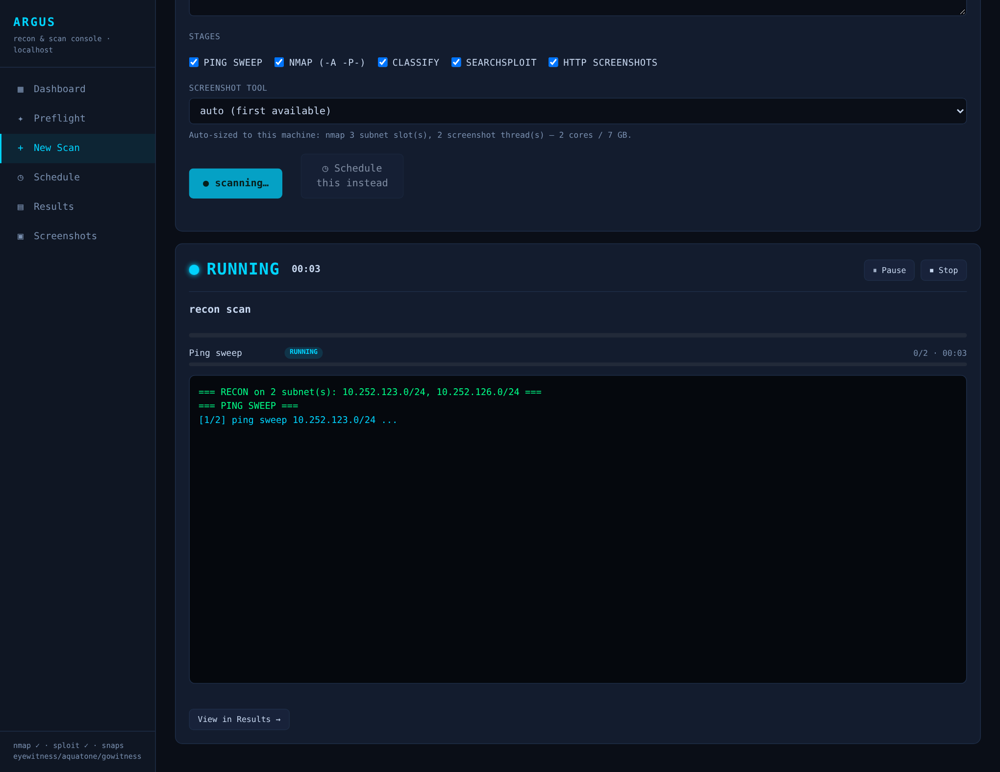
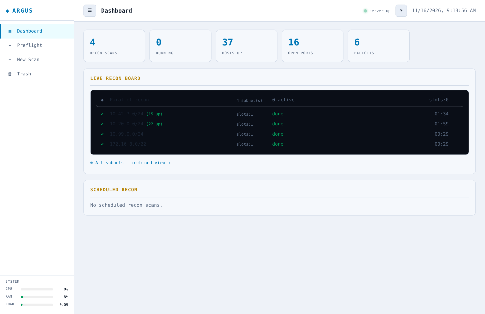

<div align="center">

# 👁️ Argus

### Network Recon & Scan Console

**One local, Nessus-style web console that unifies subnet reconnaissance and service/CVE scanning — configure, schedule, run, and review everything from a single dark-mode UI.**

*Named after Argus Panoptes, the hundred-eyed watchman of myth — the all-seeing guardian who never fully sleeps.*

</div>



---

## What is Argus?

Argus puts a clean web front-end over two existing command-line engines and runs them as managed, schedulable jobs:

- **Subnet Recon** — ping sweep → parallel, CIDR-weighted `nmap -A -p-` → service classification → `searchsploit` exploit matching → HTTP screenshots, with an auto-generated intelligence dashboard.
- **Module Scan** — 25 focused service/CVE checks (SMB/EternalBlue, RDP/BlueKeep, IPMI hash disclosure, Redis, MySQL/MSSQL, Elasticsearch, F5, WebLogic, Ghostcat, SIGRed, and more).

Everything runs **locally**, with **no external dependencies** — pure Python 3 standard library and vanilla JavaScript. Nothing to `pip install`, nothing phones home.

> **Heads-up:** Argus is offensive-security tooling. Only run it against systems you are explicitly authorized to test.

---

## Highlights

- 🎛️ **Unified console** — recon and module scans, one UI, one job model.
- ✦ **Preflight page** — live check of every module, CLI tool, and project file, with a blinking "server up" indicator and machine resource readout.
- 📅 **In-app scheduler** — pick a date on a calendar, a time, a **timezone** (type a city — "chennai" finds `Asia/Kolkata`), and a recurrence (once / daily / weekly).
- 🧵 **Independent, concurrent scans** — recon and module scans have their own Run buttons and run side by side; starting one never blocks the other.
- 🧠 **Shared resource-aware concurrency** — reads your CPU/RAM on every run and sizes nmap parallelism, scan workers, and screenshot threads, **dividing the budget across scans running at once** so the box is never overloaded.
- 🛰️ **One instance per subnet** — enter five subnets (comma or newline) and Argus launches five independent recon instances, each named and foldered by its subnet.
- 📟 **Animated live board** — a SweepNinja-style board on the Dashboard: one row per subnet with a spinner, status, slot cost, and a **ticking elapsed clock**, plus headline metric tiles — so you see at a glance what's running, done, or queued.
- 🗂️ **Dashboard = recon hub** — the board lists every subnet scan plus an **All subnets** combined view; click one to open a **full detail page** with its live output, stats, the recon intelligence dashboard inline, classification files, nmap XML, and screenshots (no separate Results/Screenshots pages).
- 🖼️ **Unified screenshot report** — aquatone-style gallery with summary tiles, by-port / by-host bar graphs, grouped by host, each shot tagged by scheme, port, detected product, and capture tool — **the same view no matter which tool took the shots**.
- 🔁 **Automatic screenshot fallback** — if the chosen tool produces zero images, Argus falls back to the next available one (aquatone → eyewitness → gowitness, in any order) until one succeeds.
- ▶️ **Live run control** — a big **RUNNING / PAUSED / COMPLETED / STOPPED** status with a running clock, **Pause / Resume / Stop**, and a **per-stage progress bar** with elapsed time and ETA. Stop terminates in-flight processes (whole process group) within ~1s. The Run button locks on click (no accidental double-starts).
- 📊 **Precise per-subnet stats + visualization** — every scan reports hosts up, live hosts, open ports, services, **high-risk services**, exploits, and components; the detail page renders an **open-services bar chart**. Risk and exploit tiles turn red when non-zero.
- 📈 **Live system monitor** — a Windows-style **CPU / RAM / load** readout in the sidebar, updating every 2s, so you can see headroom before launching more scans.
- 🗑️ **Trash & restore** — delete a subnet scan by mistake and it goes to the **Trash**, where you can restore it or delete it permanently (Nessus-style), workspace and all.
- ⇄ **Collapsible sidebar** — a hamburger toggle; collapsed to an icon rail by default, expand when you want labels. Your choice is remembered.
- 🌗 **Dark / light theme** toggle.

> **Fully modular** — the 25 service/CVE checks are plug-in *probes*. Adding one is a single Python file plus a one-line registry entry — easy to do by hand or by asking an AI assistant. See [Extending Argus](#extending-argus--add-your-own-module).

---

## Screenshots

### Preflight — know you're ready before you scan
Live status dots for all 25 modules, every CLI tool (with path + purpose), project files, and auto-computed concurrency for this machine.



### New Scan — Subnet Recon (with inline scheduling)
Enter subnets, pick stages, choose a screenshot tool. Parallelism auto-sizes to the machine. **Schedule instead** reveals an inline date / time / timezone-typeahead / recurrence panel — scheduling is recon-only.



### New Scan — Module Scan (live, inline)
Run any of the 25 modules; the exact command is shown, targets paste or upload, workers default to **auto** (shared with any running recon). Module output — status, Pause/Stop, per-module progress, and saved results — stays on this page.



### Dashboard — the animated recon hub
Pentester-focused headline metrics (hosts up, open ports, exploits) + a live board: one row per subnet with a spinner, status, slots, a ticking clock, the **host count after each subnet** once the ping sweep returns, and a hover **🗑 delete**. The sidebar shows a live **CPU / RAM / load** monitor.


### Subnet detail page — precise stats + visualization
A full page per subnet: labeled stat tiles (hosts up, live hosts, open ports, services, **high-risk**, exploits, components) with risk/exploit tiles flagged red, an **open-services bar chart**, the recon intelligence dashboard inline, classification files, nmap XML, and the screenshot gallery.



### Trash — delete & restore (Nessus-style)
Deleted subnet scans move to the Trash, where you can restore them or delete them permanently.



### Live run control
Big status, running clock, Pause/Stop, and a per-stage progress bar with ETA. The Run button locks on click.



### Light theme & collapsed sidebar


---

## Quick start

```bash
git clone https://github.com/Hari-prasaanth/argus.git
cd argus
sudo ./console.sh
```

Argus binds to `http://127.0.0.1:8800/` and opens your browser. Several stages need root (`nmap -A -p-`, NFS mount, raw/UDP), hence `sudo`.

**Headless / remote box:**

```bash
sudo ./console.sh --no-browser --port 8800
# from your laptop:
ssh -L 8800:127.0.0.1:8800 user@box      # then open http://127.0.0.1:8800
```

---

## The pages

| Page | What it does |
|------|--------------|
| **Dashboard** | The recon hub: live board of subnet scans + "All subnets", headline metrics, scheduled-recon panel, and a sidebar system monitor. A row opens a full detail page with stats, the services chart, the recon dashboard inline, classification files, nmap XML, and screenshots. Delete a row to send it to Trash. |
| **Preflight** | Verifies modules, tools, files; shows machine resources + the "up" dot. |
| **New Scan** | Two tabs with independent Run buttons. **Subnet Recon** → runs in the background (watched on the Dashboard) and carries inline **scheduling** (recon only). **Module Scan** → runs with its live terminal and results inline on this page. |
| **Trash** | Soft-deleted subnet scans; restore or delete permanently. |

See [`docs/USAGE.md`](docs/USAGE.md) for a full walkthrough and [`docs/ARCHITECTURE.md`](docs/ARCHITECTURE.md) for how it's built.

---

## Resource-aware concurrency

On every run Argus reads CPU cores and total/available RAM and derives safe limits:

| Limit | Formula | Purpose |
|-------|---------|---------|
| **Nmap slots** | `cores × ram_gb / 4`, capped 1–16 | parallel subnets (CIDR-weighted: a /8 costs more slots than a /24) |
| **Scan workers** | `~2 × cores`, bounded by ~200 MB free RAM each, capped 32 | parallel targets in a module scan |
| **Screenshot threads** | `~1 per GB`, capped by cores and 8 | headless-Chrome screenshotting (aquatone kept lower — Chrome is heavy) |

In a module scan the **Workers** field defaults to `auto` (the computed value); type a number to override.

---

## Where output lands

Each **recon** scan gets its own workspace:

```
workspaces/<scan-id>/
├── meta.json                 type, status, stats, config
├── scan.log                  full run log
├── ping_sweep.txt
├── nmap_scans/*.xml
├── Classification/           http.txt, <service>.txt, components.txt,
│                             vulnerabilities_checklist.txt, searchsploit.txt, dashboard.html
└── HTTP_Snaps/<tool>/        screenshots
```

**Module** scans all write to one **shared** tree, so every module's per-host files
accumulate under the same three buckets (run 10 modules and `vulnerable/` holds a
subfolder for each):

```
module_results/
├── all/            <module>/  <ip> Port <port>.txt …
├── vulnerable/     <module>/  …
└── not_vulnerable/ <module>/  …
```

Recon workspaces persist and reload on restart, so a scan's dashboard and screenshots
survive a console restart.

---

## Extending Argus — add your own module

Argus is **modular by design**. The 25 service/CVE checks are declarative entries in one
registry (`nsa_web.py → MODULES`), and the recommended runner is a **probe**: a standalone
Python script in `NSA/` that takes `ip port` on the command line, prints findings to stdout,
and is wired in with a single dict entry. No core code changes, no framework to learn.

**The probe contract (how Argus reads your output):**

- Your script is invoked as `python3 NSA/_nsa_<slug>.py <ip> <port>`.
- Print **one finding per line**. Any non-empty line is treated as a **finding → host is VULNERABLE**.
- Lines whose key (text before the first `:`) is a known info key are shown as *informational detail*, not a vuln.
- Print **nothing** when the host is clean. Exit 0.

**Two steps to add a module:**

1. Drop a probe at `NSA/_nsa_<slug>.py`:

   ```python
   #!/usr/bin/env python3
   import sys, socket
   ip, port = sys.argv[1], int(sys.argv[2])
   try:
       s = socket.create_connection((ip, port), timeout=5)
       banner = s.recv(256).decode(errors="replace").strip()
       s.close()
       if "VULNERABLE-MARKER" in banner:
           print("MyService exposed:", banner)   # a finding → VULNERABLE
   except Exception:
       pass                                        # no output → clean
   ```

2. Register it in `nsa_web.py → MODULES` (use the next free id):

   ```python
   26: dict(name="MyService Weak Config (CVE-XXXX-YYYY)",
           cat="Network Services", port=1234,
           slug="myservice", runner="probe", probe="_nsa_myservice.py"),
   ```

That's it — the module appears on **Preflight** and in the **Module Scan** dropdown automatically,
and its per-host output flows into the shared `module_results/{all,vulnerable,not_vulnerable}/` tree.

> **Add a module by prompt.** Because the contract is this small, you can hand it to any AI
> assistant. A prompt that works well:
>
> > *"Add an Argus module. Write a probe `NSA/_nsa_<slug>.py` that takes `ip port`, checks
> > `<service / CVE / condition>` by `<how to detect it>`, and prints one finding line per issue
> > (print nothing if the host is clean). Then add the matching `runner="probe"` entry to the
> > `MODULES` dict in `nsa_web.py` on the default port `<port>`. Follow the existing probes in
> > `NSA/` for style."*

For a quick `nmap`/CLI-based check you can instead use `runner="cmd"` and add a branch to
`build_cmd()` + `classify_cmd()` — see modules 1–6 for examples.

---

## Requirements

- **Python 3** (3.9+ for the full timezone list). Nothing else is required to run the console.
- For **recon** stages: `nmap`, `searchsploit` (`exploitdb`), and one of `eyewitness` / `aquatone` (+ chromium) / `gowitness`.
- For **modules**: `nmap`, plus per-module tools (`smbclient`, `redis-cli`, `mysql`, `snmp-check`, …). Missing tools are detected on the Preflight page and those checks are skipped with a note — the rest still run.

---

## Security

- **Localhost only.** The console executes scan commands on its host and **refuses to bind to anything but `127.0.0.1`**. Never expose it on a reachable interface — tunnel in over SSH instead.
- The in-app scheduler fires jobs only while the console process is running.
- Use only against systems you are authorized to assess.

---

## Credits

Built by [**Hari-prasaanth**](https://github.com/Hari-prasaanth) · [HexLogic](https://hexlogic.io).
Recon pipeline derived from SweepNinja; module probes from the Network Security Auditor (NSA).

## License

MIT — see [`LICENSE`](LICENSE).
